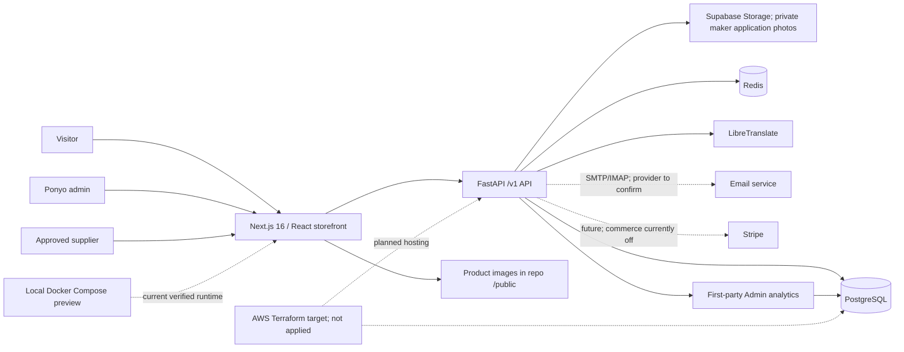

# Ponyo site blueprint

> **One-page version with all diagrams:** [site-blueprint.html](./site-blueprint.html) (24 November 2026). Where the two differ, the one-pager is newer.

**Snapshot:** 22 November 2026 · **Status:** repo-verified; local API, email authentication, and private maker-photo storage checks passed; production/vendor details remain TBC  
**Drive:** This file is ready to copy to the shared Drive. Drive folder/link and document owner are TBC; this workspace has no Drive connection.  
**Scope:** Current code and planned architecture, not proof that a production site or cloud service is deployed.

## 1. How the site fits together

The public storefront, backend API, database, and admin portal are custom Ponyo code in one repository. `src/ponyo-shopify` is a visual reference only; Shopify is not the runtime shop. The local Compose stack includes PostgreSQL, Redis, LibreTranslate, API, frontend, and a temporary Cloudflare tunnel. The AWS Terraform files describe a future deployment, but have **not** been applied.

## 2. What it is built on, and why

| Part | Technology | Why / current state |
| --- | --- | --- |
| Visitor pages and portals | Next.js 16, React 19, TypeScript | Custom storefront and protected admin/supplier experiences; not a ready-made shop platform. |
| Backend | FastAPI (Python), SQLAlchemy, Alembic | Custom typed API, business rules, and versioned relational schema; deployable separately from the frontend. |
| Data and cache | PostgreSQL; Redis | Relational product, reservation, account, and order data; Redis supports rate limiting and related runtime needs. Local Compose is verified; production cloud database is planned, not deployed. |
| Payments | Stripe integration in code | Hosted checkout and payment operations are implemented, but checkout/payment are feature-disabled pending launch decisions and testing. |
| Email | SMTP sending, IMAP inbox sync | Local SMTP authentication and read-only IMAP access passed for transactional mail and the `hello`, `support`, and `partners` inboxes on 22 November. No test message was sent; production sender verification, delivery, cost, and DNS authentication remain unverified. |
| Images | Product assets in `public/` and image URLs in product records; maker application photos in a private Supabase Storage bucket | The current local API verified the private bucket, temporary upload, and signed preview. Production configuration, costs, backup, and restore remain unverified. S3 + CloudFront for catalog images remains only in the unapplied AWS plan. |
| Analytics | First-party Admin analytics | Calculated from Ponyo database records; no external analytics product is configured in the repo. |
| Translations | next-intl UI translations; LibreTranslate service for product text | App-owned UI strings and a self-hostable translation service; production translation hosting is not established. |
| CI | GitHub Actions backend workflow | Runs backend tests and offline PostgreSQL migration SQL generation; no production deployment workflow is present in the repo. |

## 3. Outside services, cost, and renewal

No vendor invoices, account billing pages, or renewal dates are stored in the repository. **TBC means confirm from the vendor account or invoice; it is not an estimate.** Do not put credentials in this document.

| Service / purpose | Evidence and status | Monthly cost | Renewal / billing date |
| --- | --- | --- | --- |
| Domain: `byponyo.com` | Domain is referenced by the project; registrar and live DNS ownership are not established here. | TBC | TBC (likely registrar renewal cycle; confirm) |
| Website/API hosting | Local Docker preview is documented. AWS ECS/Aurora/Redis/ALB plan is not applied; actual live host is TBC. | TBC; AWS plan has variable billable resources if deployed | TBC; AWS billing cycle/account to confirm |
| Stripe payments | Integration exists in code; commerce is off. Account plan/rates are not in repo. | No fixed monthly amount documented; transaction fees/rates TBC | No renewal date documented; confirm account terms |
| SMTP/IMAP email | SMTP/IMAP authentication passed locally for configured mailboxes; no test email was sent. Confirm actual production provider, sender verification, and delivery. | TBC | TBC |
| Contact and maker forms | First-party Ponyo API and database; no external form vendor identified. | No separate vendor fee identified; hosting cost is above | N/A separately |
| Newsletter | Subscriber records are first-party in the database. A marketing-email provider/consumer is not configured. | No separate vendor identified; sending provider TBC before campaigns | TBC if a provider is selected |
| Analytics | First-party Admin reports; no external analytics vendor identified. | No separate vendor fee identified | N/A separately |
| Image storage/CDN | Current assets are repo-managed. Planned S3/CloudFront is not deployed. | TBC only if AWS storage/CDN is activated | AWS monthly billing if activated; date TBC |
| Supabase Storage (maker application photos) | Current local project/private bucket and a temporary upload/signed read were verified. Production project, retention, plan, and backup coverage remain TBC. | TBC from Supabase account | TBC from Supabase account |
| LibreTranslate | Runs as a local Compose service; production host is TBC. | No separate SaaS fee identified; compute cost depends on hosting | N/A for local container |
| GitHub Actions | Backend CI workflow exists; organization billing/usage plan is not in repo. | TBC | TBC |
| Cloudflare Quick Tunnel | Temporary local-preview tunnel only; not production hosting. | Account/plan cost TBC | Not a production renewal |

## 4. Page inventory

**Status key:** “Live in code” means implemented/available in this app, not independently verified on the public production domain. “Hidden” means a feature flag or access control prevents normal visitor access. Confirm the production domain before describing any page as live to customers.

| Page / route | Status | Notes |
| --- | --- | --- |
| `/` | Live in code | Homepage. |
| `/shop`, `/search` | Live in code | Catalog discovery and search. |
| `/collections`, `/collections/[slug]` | Live in code | Collection index and detail. |
| `/products/[id]` | Live in code | Product detail and non-payment reservation/interest flow. |
| `/makers/[slug]` | Live in code | Maker profile. |
| `/for-makers` | Live in code | Maker application form; it does not create a product listing. |
| `/size-guide` | Live in code | Size guide. |
| `/pages/about`, `/pages/faq`, `/pages/contact`, `/pages/domina-xl`, `/pages/partners` | Live in code | Informational and contact pages; verify content and contact monitoring before launch. |
| `/pages/specified-commercial-transactions-act-disclosure`, `/pages/privacy-policy`, `/pages/terms-and-returns`, `/pages/terms-of-service`, `/pages/returns-policy` | Draft | Explicit legal placeholders; require business details and appropriate review before publication. |
| `/newsletter/unsubscribe` | Live in code | Tokenized unsubscribe utility. |
| `/wishlist` | Live in code | Browser-local wishlist; customer account sync is unavailable while accounts are disabled. |
| `/cart`, `/checkout` | Hidden | Commerce feature flag is off; do not enable until launch prerequisites are complete. |
| `/account`, `/account/login`, `/account/register`, `/account/verify-email`, `/account/forgot-password`, `/account/reset-password`, `/account/addresses`, `/orders` | Hidden | Customer-account feature flag is off. |
| `/blogs/[handle]`, `/blogs/[handle]/[article]` | Hidden | Plush Journal feature flag is off. |
| `/admin-portal` | Restricted | Admin-role access required; not a visitor page. |
| `/supplier-portal` | Restricted | Supplier-role access required; supplier subdomain/DNS/HTTPS are not established by this repo. |

## 5. Data location and export

The app's current local preview uses PostgreSQL in a Docker named volume. The production database target in Terraform is Aurora PostgreSQL, but it is not deployed. Browser-local cart/wishlist preview data is separate from server records.

| Data | Stored in | Export / current limitation |
| --- | --- | --- |
| Products, variants, maker/brand details, supplier terms, translations | PostgreSQL tables; product image files in the repository's `public/` assets | No dedicated product export workflow is documented. Assets can be obtained from the source repository; database export requires an authorized database process. |
| Reservations and product-interest registrations | PostgreSQL (`product_reservations` and separate interest records) | Admin supports filtered reservation CSV and XLSX export. No matching interest-export action is verified. |
| Newsletter emails and consent/status | PostgreSQL (`newsletter_subscriptions`) | Admin can list subscribers; no one-click export is verified. Marketing provider is not configured. |
| Customer accounts and addresses | PostgreSQL (`customers`, address records); account UI is disabled | No customer self-service data export or admin bulk export is verified. Use an authorized database export process if required. |
| Maker applications and photos | Application details and private photo object paths in PostgreSQL (`maker_applications`); photo files in the private Supabase bucket | Local upload and signed preview are verified. Application data requires an authorized database export; photo files require an authorized Supabase Storage export. Production retention and backup coverage for both are TBC. |

## 6. Backups and restore

- **Local preview:** PostgreSQL data persists in a Docker named volume; no scheduled backup is defined in Compose.
- **Planned AWS:** Terraform configures Aurora point-in-time recovery with a 14-day default retention if deployed.
- **Maker photos:** Supabase Storage backup/retention and restore behavior are not verified; confirm coverage and test retrieval independently from the PostgreSQL backup.
- **Restore test:** No restore drill is recorded as completed. Automated retention is not proof of a tested restore.
- **Before launch:** confirm the actual production backup policy, RPO/RTO, access, and run a restore into an isolated environment; record date, recovery point, duration, and result.

## 7. How a change reaches the site

- **Code:** changes are made in the GitHub repository. The backend GitHub Actions workflow runs tests and generates PostgreSQL migration SQL; it does not deploy. No frontend or production deploy workflow is documented.
- **Local preview:** `docker compose up --build -d` builds/runs the local stack. The optional Cloudflare Quick Tunnel is temporary and is not a staging environment.
- **Test copy:** no separate, persistent staging site/database is documented. Treat this as **not confirmed / not available until verified**, not as a safe production-like test environment.
- **Production publish authority:** hosting-account deploy permissions and the person who can release code are TBC. Admin-role users can publish/unpublish existing products in the admin portal; that is separate from deploying a code change.
- **Release checklist:** confirm a staging copy, run frontend/backend checks and migrations against the intended database, review the change, then deploy using a documented authorized release process. Do not apply the unapplied AWS plan without account, budget, domain, and deployment review.

## 8. How a product is added today

The partner path is **Maker application → acceptance and onboarding invitation → maker onboarding review → brand and inactive supplier setup → Supplier Portal activation → supplier product draft → admin approval → separate publication**. Acceptance does not activate a supplier, and onboarding approval does not publish a product. Supplier accounts are bound through `SupplierAccount`, so an existing customer account may also receive supplier access without changing its customer role.

Admin product approval creates an unpublished product, default variant, supplier offer, and inventory record. New partner products have checkout disabled by default: Admin can publish a preview, then separately enable checkout once availability and operations are ready. The Admin publication action checks Japanese and Korean translations before making the product visible. Supplier cost/capacity changes continue to require Ponyo approval; retail price uses approved wholesale cost +20%. New supplier product images use the separate `SUPABASE_PRODUCT_IMAGES_BUCKET`; provision it as a public Supabase Storage bucket and keep the service-role key backend-only. Maker-application photos remain in their private bucket.

**Before launch:** configure and verify the public product-image bucket, SMTP delivery of both onboarding invitations, token expiry and activation, product translation support, and the database migration. Checkout/payment availability remains governed by the existing product and checkout configuration; product publication alone is not proof that payment is enabled.

**Time per product:** no measured turnaround is recorded. Time one complete pilot from supplier draft through review, translation, and publication before setting an estimate.

## Walkthrough and maintenance

**Requested meeting:** 30 minutes. Suggested agenda: architecture/hosting (8 min), vendor costs and renewal dates (7 min), pages/data/backups/release process (8 min), product onboarding and owners/actions (7 min). **Not booked:** calendar access and attendee availability are not available in this workspace.

Update this blueprint when a vendor, hosting environment, route/feature flag, data store/export, backup process, release authority, or product-intake workflow changes. Fill all TBC costs, renewal dates, production URL/host, staging URL, backup result, and document owner from the relevant vendor accounts and operations owner. Keep secrets and customer data out of the Drive copy.

**Repo references:** [README](../README.md), [backend README](../backend/README.md), [database guide](./storefront-database.md), [operations reliability](./operations-reliability.md), and [AWS Terraform guide](../infra/terraform/README.md).
