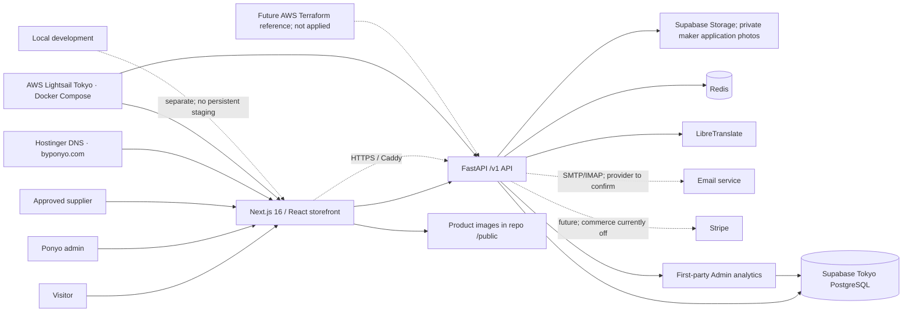

# Ponyo site blueprint

> **One-page version with all diagrams:** [site-blueprint.html](./site-blueprint.html) (updated 27 November 2026).

**Snapshot:** 27 November 2026 · **Status:** storefront and API are live on AWS Lightsail Tokyo; site/API HTTPS and the `www` redirect were smoke-tested.

**Production update:** Releases are manual Docker Compose deployments; no automatic deploy or persistent staging environment is documented. The production database is Supabase Tokyo. Stripe remains off. A manual database dump was validated, but scheduled backups and a restore test are not verified. See the [production operations runbook](./production-operations-runbook.md).

**Drive:** This file is ready to copy to the shared Drive. Drive folder/link and document owner are TBC; this workspace has no Drive connection.
**Scope:** Repository-verified architecture plus production checks reported on 27 November. Vendor costs, renewal dates, backup policy, and restore readiness still require confirmation.

## 1. How the site fits together

The storefront, backend API and portals are custom Ponyo code in one repository. `src/ponyo-shopify` is a visual reference only; Shopify is not the runtime shop. Production frontend, API, Caddy, Redis and LibreTranslate run in Docker Compose on Lightsail Tokyo; PostgreSQL is hosted by Supabase Tokyo. The AWS Terraform files describe a separate future architecture and have **not** been applied.

## 2. What it is built on, and why

| Part | Technology | Why / current state |
| --- | --- | --- |
| Visitor pages and portals | Next.js 16, React 19, TypeScript | Custom storefront and protected admin/supplier experiences; not a ready-made shop platform. |
| Backend | FastAPI (Python), SQLAlchemy, Alembic | Custom typed API, business rules, and versioned relational schema; deployable separately from the frontend. |
| Data and cache | Supabase Tokyo PostgreSQL; Redis on Lightsail | Relational product, reservation, account, and order data; Redis supports rate limiting and related runtime needs. Production database and app host are live. |
| Payments | Stripe integration in code | Hosted checkout and payment operations are implemented, but checkout/payment are feature-disabled pending launch decisions and testing. |
| Email | SMTP sending, IMAP inbox sync | Local SMTP authentication and read-only IMAP access passed for transactional mail and the `hello`, `support`, and `partners` inboxes on 22 November. No test message was sent; production sender verification, delivery, cost, and DNS authentication remain unverified. |
| Images | Product assets in `public/` and Supabase Storage buckets | Product and private maker-application images use Supabase Storage; confirm production retention and backup coverage. S3 + CloudFront remains only in the unapplied AWS plan. |
| Analytics | First-party Admin analytics | Calculated from Ponyo database records; no external analytics product is configured in the repo. |
| Translations | next-intl UI translations; LibreTranslate on Lightsail | App-owned UI strings and self-hosted product text translation in production. |
| CI | GitHub Actions backend workflow | Runs backend tests and offline PostgreSQL migration SQL generation; no production deployment workflow is present in the repo. |

## 3. Outside services, cost, and renewal

No vendor invoices, account billing pages, or renewal dates are stored in the repository. **TBC means confirm from the vendor account or invoice; it is not an estimate.** Do not put credentials in this document.

| Service / purpose | Evidence and status | Monthly cost | Renewal / billing date |
| --- | --- | --- | --- |
| Domain: `byponyo.com` | Hostinger manages domain/DNS; production records point to Lightsail and HTTPS is active. | TBC from Hostinger billing | TBC from Hostinger account |
| Website/API hosting | AWS Lightsail Tokyo; Docker Compose, Caddy, frontend and API are live. | TBC from AWS billing | Monthly AWS billing; exact date TBC |
| Stripe payments | Integration exists in code; commerce is off. Account plan/rates are not in repo. | No fixed monthly amount documented; transaction fees/rates TBC | No renewal date documented; confirm account terms |
| SMTP/IMAP email | Hostinger mailboxes; logins tested, but production sending and delivery test not recorded. | TBC | TBC |
| Contact and maker forms | First-party Ponyo API and database; no external form vendor identified. | No separate vendor fee identified; hosting cost is above | N/A separately |
| Newsletter | Subscriber records are first-party in the database. A marketing-email provider/consumer is not configured. | No separate vendor identified; sending provider TBC before campaigns | TBC if a provider is selected |
| Analytics | First-party Admin reports; no external analytics vendor identified. | No separate vendor fee identified | N/A separately |
| Image storage/CDN | Repository assets and Supabase Storage are used; no CDN confirmed. | TBC from Supabase billing | TBC from Supabase account |
| Supabase database and storage | Production database is Supabase Tokyo; storage holds product and private application photos. | TBC from Supabase account | TBC from Supabase account |
| LibreTranslate | Self-hosted in the production Compose stack. | Included in AWS compute; exact cost TBC | Monthly AWS billing |
| GitHub Actions | Backend CI workflow exists; organization billing/usage plan is not in repo. | TBC | TBC |
| Cloudflare Quick Tunnel | Temporary local-preview tunnel only; not production hosting. | Account/plan cost TBC | Not a production renewal |

## 4. Page inventory

**Status key:** “Live in code” means implemented/available in this app, not independently verified on the public production domain. “Hidden” means a feature flag or access control prevents normal visitor access. Confirm the production domain before describing any page as live to customers.

| Page / route | Status | Notes |
| --- | --- | --- |
| `/` | Live in code | Homepage. |
| `/shop`, `/search` | Live in code | Catalog discovery and search. |
| `/collections`, `/collections/[slug]` | Live in code | Collection index and detail. |
| `/products/[id]` | Live in code | Product detail and non-payment reservation/interest flow. |
| `/makers/[slug]` | Live in code | Maker profile. |
| `/for-makers` | Live in code | Maker application form; it does not create a product listing. |
| `/size-guide` | Live in code | Size guide. |
| `/pages/about`, `/pages/faq`, `/pages/contact`, `/pages/domina-xl`, `/pages/partners` | Live in code | Informational and contact pages; verify content and contact monitoring before launch. |
| `/pages/specified-commercial-transactions-act-disclosure`, `/pages/privacy-policy`, `/pages/terms-and-returns`, `/pages/terms-of-service`, `/pages/returns-policy` | Draft | Explicit legal placeholders; require business details and appropriate review before publication. |
| `/newsletter/unsubscribe` | Live in code | Tokenized unsubscribe utility. |
| `/wishlist` | Live in code | Browser-local wishlist; customer account sync is unavailable while accounts are disabled. |
| `/cart`, `/checkout` | Hidden | Commerce feature flag is off; do not enable until launch prerequisites are complete. |
| `/account`, `/account/login`, `/account/register`, `/account/verify-email`, `/account/forgot-password`, `/account/reset-password`, `/account/addresses`, `/orders` | Hidden | Customer-account feature flag is off. |
| `/blogs/[handle]`, `/blogs/[handle]/[article]` | Hidden | Plush Journal feature flag is off. |
| `/admin-portal` | Restricted | Admin-role access required; not a visitor page. |
| `/supplier-portal` | Restricted | Supplier-role access required at `suppliers.byponyo.com`. |

## 5. Data location and export

Production server records are stored in the Supabase Tokyo PostgreSQL database. An authorized operator can export the database with a standard PostgreSQL dump. Browser-local cart/wishlist data is separate from server records.

| Data | Stored in | Export / current limitation |
| --- | --- | --- |
| Products, variants, maker/brand details, supplier terms, translations | PostgreSQL tables; product image files in the repository's `public/` assets | No dedicated product export workflow is documented. Assets can be obtained from the source repository; database export requires an authorized database process. |
| Reservations and product-interest registrations | PostgreSQL (`product_reservations` and separate interest records) | Admin supports filtered reservation CSV and XLSX export. No matching interest-export action is verified. |
| Newsletter emails and consent/status | PostgreSQL (`newsletter_subscriptions`) | Admin can list subscribers; no one-click export is verified. Marketing provider is not configured. |
| Customer accounts and addresses | PostgreSQL (`customers`, address records); account UI is disabled | No customer self-service data export or admin bulk export is verified. Use an authorized database export process if required. |
| Maker applications and photos | Application details and private photo object paths in PostgreSQL (`maker_applications`); photo files in the private Supabase bucket | Local upload and signed preview are verified. Application data requires an authorized database export; photo files require an authorized Supabase Storage export. Production retention and backup coverage for both are TBC. |

## 6. Backups and restore

- **Production database:** One manual pre-migration dump was validated; scheduled backups depend on the Supabase plan and have not been verified.
- **Uploaded photos:** Supabase Storage backup/retention and restore behavior are not verified; confirm coverage and test retrieval independently from the PostgreSQL backup.
- **Restore test:** No restore drill is recorded as completed. Automated retention is not proof of a tested restore.
- **Operational follow-up:** confirm the production backup policy, RPO/RTO and access; run a restore into an isolated environment and record date, recovery point, duration, and result.

## 7. How a change reaches the site

- **Code:** changes are made in GitHub. GitHub Actions runs backend checks but does not deploy. An authorized operator connects to Lightsail by SSH, pulls the reviewed commit and rebuilds/restarts Docker Compose.
- **Local preview:** `docker compose up --build -d` builds/runs the local stack. The optional Cloudflare Quick Tunnel is temporary and is not a staging environment.
- **Test copy:** no separate, persistent staging site/database is documented. Treat this as **not confirmed / not available until verified**, not as a safe production-like test environment.
- **Production publish authority:** authorized GitHub contributors and Lightsail access can release code; the named release owner is TBC. Admin-role users can publish/unpublish products separately.
- **Release checklist:** review the change, run available checks, verify migrations against the intended database, then deploy using the [production operations runbook](./production-operations-runbook.md). There is no permanent staging copy.

## 8. How a product is added today

The partner path is **Maker application → acceptance and onboarding invitation → maker onboarding review → brand and inactive supplier setup → Supplier Portal activation → supplier product draft → admin approval → separate publication**. Acceptance does not activate a supplier, and onboarding approval does not publish a product. Supplier accounts are bound through `SupplierAccount`, so an existing customer account may also receive supplier access without changing its customer role.

Admin product approval creates an unpublished product, default variant, supplier offer, and inventory record. New partner products have checkout disabled by default: Admin can publish a preview, then separately enable checkout once availability and operations are ready. The Admin publication action checks Japanese and Korean translations before making the product visible. Supplier cost/capacity changes continue to require Ponyo approval; retail price uses approved wholesale cost +20%. New supplier product images use the separate `SUPABASE_PRODUCT_IMAGES_BUCKET`; provision it as a public Supabase Storage bucket and keep the service-role key backend-only. Maker-application photos remain in their private bucket.

**Operational follow-up:** verify production product-image bucket permissions and backup coverage, test SMTP delivery of onboarding invitations, and confirm token expiry and activation behavior. Checkout/payment remains off; product publication alone does not enable payment.

**Time per product:** no measured turnaround is recorded. Time one complete pilot from supplier draft through review, translation, and publication before setting an estimate.

## Walkthrough and maintenance

**Requested meeting:** 30 minutes. Suggested agenda: architecture/hosting (8 min), vendor costs and renewal dates (7 min), pages/data/backups/release process (8 min), product onboarding and owners/actions (7 min). **Not booked:** calendar access and attendee availability are not available in this workspace.

Update this blueprint when a vendor, hosting environment, route/feature flag, data store/export, backup process, release authority, or product-intake workflow changes. Fill all TBC costs, renewal dates, production URL/host, staging URL, backup result, and document owner from the relevant vendor accounts and operations owner. Keep secrets and customer data out of the Drive copy.

**Repo references:** [README](../README.md), [backend README](../backend/README.md), [database guide](./storefront-database.md), [operations reliability](./operations-reliability.md), and [AWS Terraform guide](../infra/terraform/README.md).
